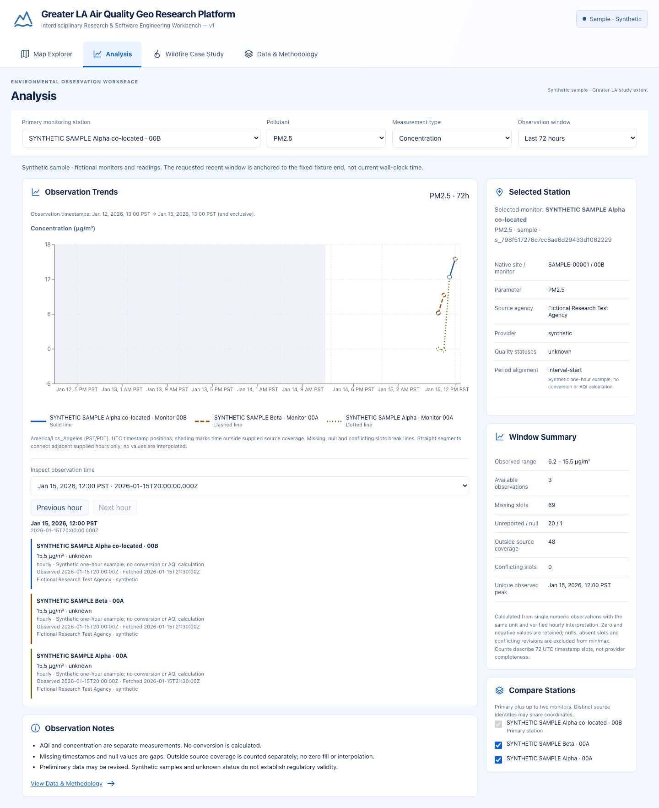

# Greater LA Air Quality Geo Research Platform

**Interdisciplinary Research & Software Engineering Workbench — v1**

A local-first TypeScript workbench for exploring air-quality measurements and the geographic context of the 2025 Eaton Fire. Built as a **4–5 minute technical interview demonstration**: React + ArcGIS, an Express data boundary, strict Zod contracts and isolated PostgreSQL snapshots.

The engineering focus is trustworthy interpretation: missing measurements stay missing, AQI stays separate from concentration, and historical exports carry source evidence. This is a research/interview PoC, not a regulatory or emergency-response product.

[Demo script](docs/release/demo-guide.md) · [Architecture](docs/release/architecture.md) · [Release review](docs/milestones/10-v1-freeze-review.md) · [Known limitations](docs/release/known-issues.md)

## Explore four pages

| Page                | Implemented behavior                                                                   | Data evidence                                                                                |
| ------------------- | -------------------------------------------------------------------------------------- | -------------------------------------------------------------------------------------------- |
| Map Explorer        | 2D map, region/pollutant/product filters, station detail → Analysis                    | Clearly synthetic station/area/forecast examples; optional official stored station snapshots |
| Analysis            | One 24/48/72-hour chart, up to three compatible monitors, gaps, UTC/PST/PDT inspection | Source units, averaging, revisions and nulls retained                                        |
| Wildfire Case Study | One Eaton case, static perimeter, SRA/LRA hazard context and monitor checkpoints       | Official EPA/CAL FIRE/OSFM snapshots; 71 supplied hourly observations in 72 slots            |
| Data & Methodology  | Sources, preview/export, methods, measured API usage                                   | CSV/JSON manifests; actual process counters; explicit unavailable sources                    |



[Actual Map](docs/release/screenshots/map-1440.png) · [Eaton case](docs/release/screenshots/wildfire-1440.png) · [Sources](docs/release/screenshots/data-1440.png). These are runtime captures, not the original design mockups. Online basemaps require network access and a permitted public ArcGIS token; the keyless fallback retains data inspection.

## Run locally

Use **Node 24 LTS and npm 11+**. From a fresh checkout:

```sh
npm ci
npm run dev
```

Open [Map Explorer](http://127.0.0.1:5173/map) or the [Eaton case](http://127.0.0.1:5173/wildfire). API: [health](http://127.0.0.1:3001/api/health). The default synthetic fixture and checked-in historical case require no provider keys or database. Root dev builds/watches shared contracts and starts both services. Stop with Ctrl-C.

For the complete PostgreSQL demo, reuse the dedicated project target and its ignored credentials:

```sh
docker compose -f compose.postgresql.yml start postgresql
npm run db:status
npm run db:migrate
npm run db:seed:sample -- --target air_quality_geo_research
npm run db:seed:historical-case -- --target air_quality_geo_research
npm run dev
```

On a new machine, see [initial database setup](docs/architecture/database.md) for the setup command and required cached PostgreSQL image. Setup refuses existing resources; it is not a restart command. The approved container is **air-quality-geo-research-platform-postgresql** at loopback port **55436**, with separate development/test databases. Seeds are idempotent and never reset volumes or relabel sample records as history.

Optional keys are described in [.env.example](.env.example). Only the exact public ArcGIS variable reaches the browser; restrict its referrers and privileges. AirNow/AQS/OpenAI credentials remain server-only. **AirNow production codecs and authenticated AQS ingestion are unavailable**; supplying keys does not enable them. No provider API test runs without opt-in. No AI feature is required for V1.

## Quality and reproducibility

```sh
npm run lint
npm run typecheck
npm test
npm run build
npm run test:db:local
npx playwright install chromium
npm run test:e2e
```

Tests use fixtures; database integration uses only the separate project test database. Playwright starts keyless services on isolated ports 5174/3103. CI provisions ephemeral PostgreSQL 17; the local target uses PostgreSQL 18. See the [dated review](docs/milestones/10-v1-freeze-review.md) for exact outcomes and the remotely verified baseline commit. Uncommitted review changes have no remote CI result yet.

With the app and project database running, `node scripts/capture-v1.mjs` regenerates screenshots and a local verification report. It uses the configured browser token; keyless screenshots truthfully show the fallback.

## Scope and limits

- Eaton is a bounded Jan 6–8, 2025 PST study at one monitor; the incident lasted Jan 7–31. The final perimeter is static; 2025 LRA recommendations postdate ignition. Neither describes hourly fire growth or present risk.
- EPA provenance does not establish per-row certification. Source qualifiers, UTC timestamps and revisions remain available. No smoke/traffic source attribution is calculated.
- Live AirNow, official area forecasts/contours, 3D, independent elevation analysis, RAG and cloud deployment remain unavailable or outside Core V1. Prompt 11 is the optional extension below; Prompt 12 remains future work.
- Exports select at most 500 rows/3 MB. Usage resets on server restart and excludes browser ArcGIS traffic and billing. Online tiles are not cached for offline use.

Source tree: `apps/web` (React/ArcGIS), `apps/api` (Express/providers/storage), `packages/contracts` (Zod), `fixtures` (synthetic and historical), `db/migrations` (append-only), `tests` (unit/API/DB/browser).

Details: [provider evidence](docs/data-sources/provider-capabilities.md), [scientific semantics](docs/research/data-semantics.md), [exports](docs/architecture/data-exports.md), [database recovery rules](docs/architecture/database.md), [engineering interview stories](docs/release/engineering-stories.md).

## Optional AI extension — Prompt 11

Analysis now includes a collapsed, optional **Research Assistant** for three preset questions about selected station ranges, missingness and comparison. It is disabled by default. With a server-only `OPENAI_API_KEY` and `RESEARCH_ASSISTANT_ENABLED=true`, clicking **Ask Research Assistant** makes one bounded paid OpenAI tool-routing call. Source records stay local; numbers and citations come from validated domain services. No fifth page, free-form chatbot or RAG is added. Core V1 remains usable without a key.

See [architecture, setup, limits and gated smoke](docs/architecture/research-assistant.md) and the [Prompt 11 verification report](docs/milestones/11-read-only-assistant.md). The V1 freeze report remains a record of its original baseline; it does not certify this extension.
